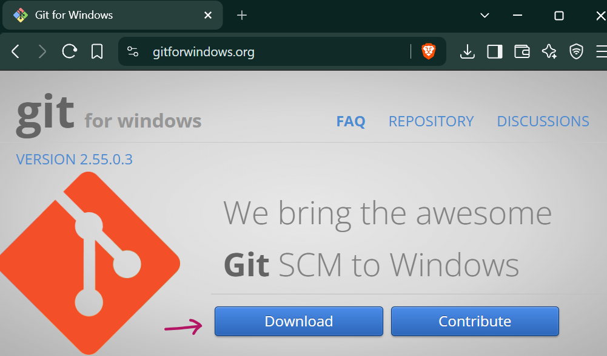
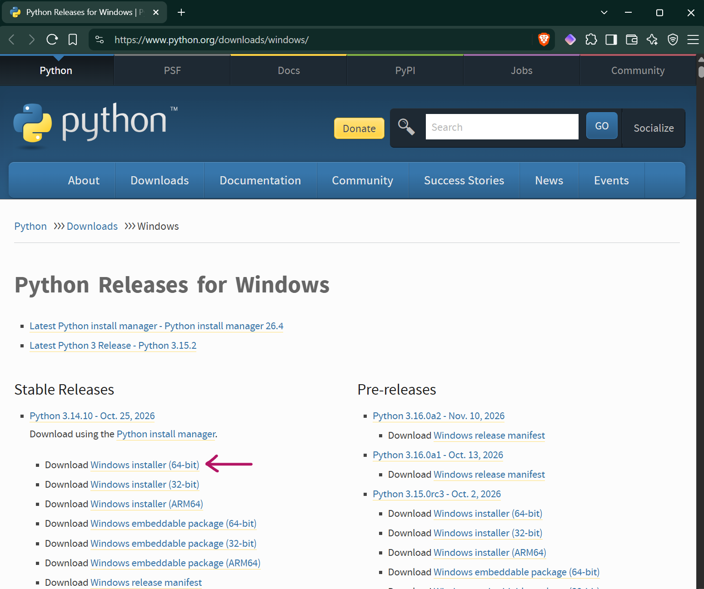
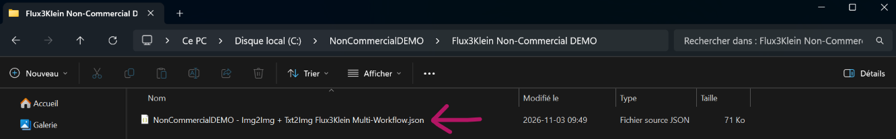
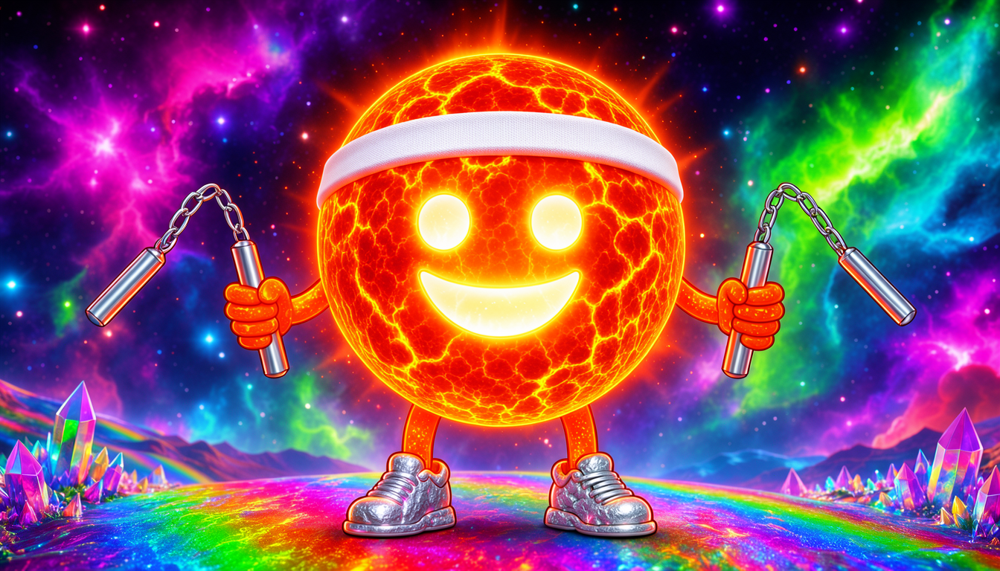
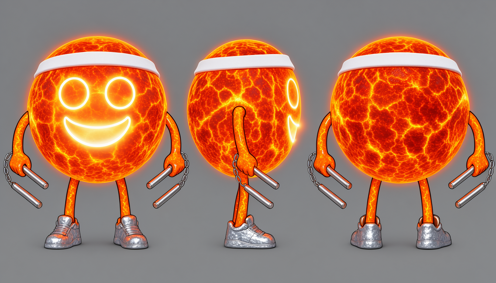
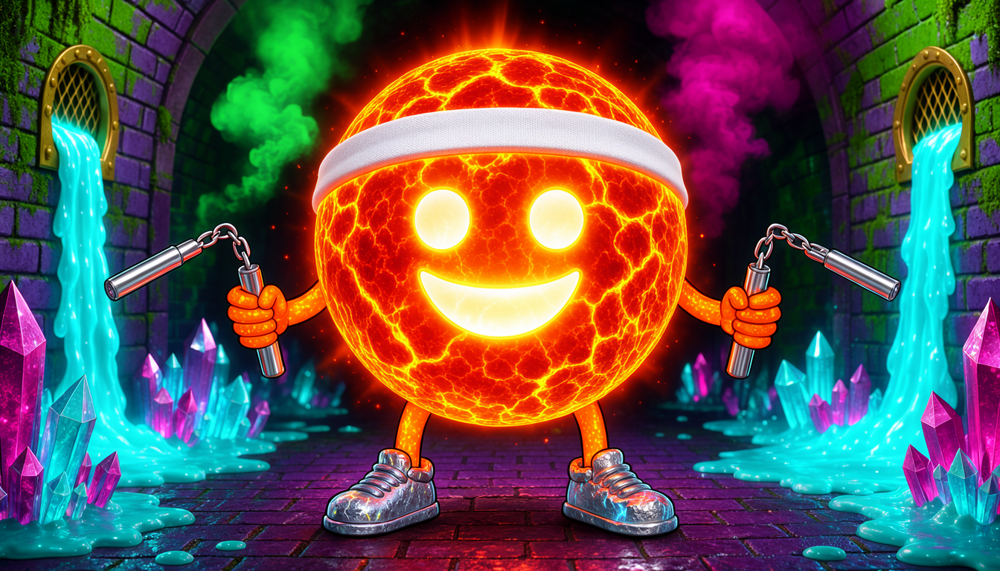

# 🌞 Superklok Labs Non-Commercial Image-Generation DEMO v1.97.0


Welcome to the OFFICIAL **Superklok Labs** non-commercial image-generation demo! This repository provides access to our production-grade pipeline utilized to build, iterate, and stylize the core character asset of the **TrenchPetals** universe: **Sunny Chuxem**.

⚠️ **Licensing & Usage Note:** This demonstration environment is distributed under the **Superklok Labs Non-Commercial Demo Asset License v1.0** due to core model dependencies falling under non-commercial restrictions. These workflows are intended exclusively for educational, research, and evaluation purposes. For full trademark, asset rules, and multi-platform attribution policies, please review the accompanying `LICENSE` file.

---

## 📋 DEMO Pipeline Key Features


*   **Advanced Impact Pack Integration:** Features a triple-tier detailing assembly leveraging targeted `FaceDetailer`, `HandDetailer`, and `FootDetailer` nodes to automatically enforce precise cell-shaded lines and lock down the character's signature 1930s rubber-hose aesthetic.
*   **Centralized Master Switch Logic:** Outlines our modular configuration topology using an integrated `ImpactSwitch` array linked to a main `MASTER SWITCH` primitive node. This allows developers to toggle between complex prompt pipelines and distinct layout configurations instantly without structural breakages.
*   **Rectified Flow Negative Conditioning:** Demonstrates high-precision formatting tricks for text conditioning layers using specialized `FluxGuidance` nodes to correctly inject structural negative overrides within the transformer stack.

---

## 🏗️ Repository Architecture & Workflows

This toolkit includes two discrete operational pipelines mapped directly to their respective architectural generations:

### Flux2Klein DEMO Pipeline
*   **Workflow File:** `NonCommercialDEMO - Img2Img + Txt2Img Flux2Klein Multi-Workflow.json`
*   **Core Checkpoint Target:** `flux-2-klein-9b-fp8.safetensors`
*   **Text Encoder Requirement:** `qwen_3_8b_fp8mixed.safetensors`
*   **Detailing Pass Profile:** 15 localized steps utilizing custom `karras` scheduler hooks.

### Flux3Klein DEMO Pipeline
*   **Workflow File:** `NonCommercialDEMO - Img2Img + Txt2Img Flux3Klein Multi-Workflow.json`
*   **Core Checkpoint Target:** `flux3-image-klein-int8-convrot.safetensors`
*   **Text Encoder Requirement:** `flux-3-image-klein-text_encoder-FP8.safetensors`
*   **Detailing Pass Profile:** 20 localized steps running on synchronized `beta` scheduling logic for ultra-crisp refinement.

### ⚙️ System Requirements
* **Recommended Operating System:** Windows 11
* **Minimum Processor:** Intel Core i5-10400
* **Memory:** 32GB RAM
* **Recommended Graphics Card:** Nvidia RTX 50 Series GPU - Minimum 16GB VRAM
* **Required Storage Space:** 45GB

---

## 🎨 Step-by-Step Setup: ComfyUI Automation Workflow

Follow these steps to configure the image-generation pipeline. This workflow is optimized to run on a single 16GB VRAM graphics card.

---

> ⚠️ **IMPORTANT NOTE:** Download **NonCommercialDEMO** directly to the folder location where you intend to run your applications. **NonCommercialDEMO** is a fully portable and 100% offline-capable environment. All related application files, models, and caches live strictly inside the main installation folder. Once set up, you can completely disconnect your system from the internet without losing any functionality.

### Step 1: Install ComfyUI (Portable Windows Build)



1. You will first need to install Git for Windows from the official page (https://gitforwindows.org/). The direct download link is https://github.com/git-for-windows/git/releases/download/v2.55.0.windows.3/Git-2.55.0.3-64-bit.exe



2. Download and install the newest version of Python for Windows from the official page (https://www.python.org/downloads/windows/). The direct download link for the 64-bit Windows installer is https://www.python.org/ftp/python/3.14.10/python-3.14.10-amd64.exe

> ⚠️ **NOTE:** Make sure to check "Add Python to PATH" when installing the newest version of Python.

3. Download or clone this repository (`NonCommercialDEMO/`) directly to the location on your hard drive where you intend to run the application.

 ➡️ 

4. Open a standard terminal window directly inside the main `NonCommercialDEMO/` directory path (Type `cmd` in your Windows file explorer address bar and press **Enter**).

 ➡️ 

5. Run the automated visual installer script using the native Python command:

```bash
python noncommercialdemo-comfyui-installer.py
```


The background engine will autonomously download the portable ComfyUI base, clone all dependency core layers, fetch all required models, and automatically load the input image files.

6. Close the Command Prompt terminal window once the setup operation is complete.

---

### Step 2: Load the Automated Workflow


1. Browse to your `NonCommercialDEMO\Image-Generation\ComfyUI_windows_portable` folder and double-click your `run_nvidia_gpu.bat` file. A browser window will open automatically at `http://127.0.0.1:8188`. It may take a couple minutes to launch for the first time after installing ComfyUI.




2. Locate the `NonCommercialDEMO - Img2Img + Txt2Img Flux2Klein Multi-Workflow.json` and `NonCommercialDEMO - Img2Img + Txt2Img Flux3Klein Multi-Workflow.json` workflow files inside the `NonCommercialDEMO\` folder and choose the one you would like to load up. Both workflows have a master switch where option `1` generates multi-colour character portraits of Sunny Chuxem walking through a colourful alien planet, and option `2` generates orthogonal character turnaround sheets.


3. To continue this walkthrough, we will use the `NonCommercialDEMO - Img2Img + Txt2Img Flux3Klein Multi-Workflow.json` workflow as our example. Drag and drop the `NonCommercialDEMO - Img2Img + Txt2Img Flux3Klein Multi-Workflow.json` workflow file directly into the ComfyUI browser interface to load the automated pipeline.


4. Once ComfyUI has installed, go to the `Sunny Chuxem Character Image` node on the far left of the workflow, click `choose file to upload`, navigate to the `NonCommercialDEMO\Sunny Chuxem Character Info\Skins` folder and select the `Sunny Chuxem - Alien World.png` image to upload.


5. Go to the `Widescreen Canvas` node on the far left of the workflow, click `choose file to upload`, navigate to the `NonCommercialDEMO\Assets` folder and select the `Alien World Canvas.png` image to upload.
> 🎨 **NOTE:** The `Alien World Canvas.png` will influence the image-generation output to favour colourful images. There is also a `StudioCanvas.png` that you can upload instead, which will output less vibrant, more character-focused portraits.

6. If you would like to generate images using the Flux2Klein workflow, go into the `NonCommercialDEMO\` then drag and drop the `NonCommercialDEMO - Img2Img + Txt2Img Flux2Klein Multi-Workflow.json` workflow directly into the ComfyUI browser interface to load the automated pipeline. Then you'll be all set to generate Flux2Klein portraits and turnaround sheets.

> 🌞 **NOTE:** Use `Sunny Chuxem.png` from the `NonCommercialDEMO\Sunny Chuxem Character Info\Skins` folder if you would like to experiment with your own custom prompts. You can use the `Widescreen Canvas` node to swap the widescreen canvas that surrounds the square character image to influence how the image background is generated.


7. Enter the number of images you would like to generate sequentially, then press `Run` to render the amount of images you requested. Click the picture icon in the left sidebar to review your generated assets. You can drag and drop any generated images right back into ComfyUI to load the workflow, custom nodes and text prompts that were used to generate that original image. By default, ComfyUI stores all your workflow metadata inside the images you generate. If you would like to remove this information, feel free to use the OFFICIAL Superklok Labs [ImageCleaner](https://github.com/Superklok/ImageCleaner). This character portrait was generated using the `Master Switch Option (1)` in the `NonCommercialDEMO - Img2Img + Txt2Img Flux3Klein Multi-Workflow.json` workflow: 



Here's an example of an orthogonal character turnaround sheet that was generated using `Master Switch Option (2)` in the `NonCommercialDEMO - Img2Img + Txt2Img Flux3Klein Multi-Workflow.json` workflow:




Your Non-Commercial Image-Generation DEMO Pipeline is ready to go, and the prompts can easily be modified to render portraits and turnaround sheets of your own custom characters!

---

## USER GUIDE


1. Load your character reference image. This workflow was specifically designed to interpret primitive MS Paint sketches or hand drawings to influence your generated output images.


2. Load your canvas reference image. This version of the `NonCommercialDEMO` workflow was designed to allow you to import a reference image for the background that is wider than the character image so that the workflow can automatically place the character in the middle of your chosen canvas to influence background elements of the generated images. Types of images you can upload into this node include but are not limited to; plain solid colours, gradient colours, photographed real world locations, and any other landscape images. This repository includes optimized 1344x768 `Alien World Canvas.png` and `StudioCanvas.png` files in the `NonCommercialDEMO\Assets` folder. Use `Alien World Canvas.png` to influence saturated colourful images, and select `StudioCanvas.png` for more neutral image generation.


3. Enter your positive text prompt for the character description to be used in **BOTH** `Master Switch Option (1)` and `Master Switch Option (2)`.


4. Enter your positive text prompt to use for describing the environment setting when generating character portraits **ONLY** when using `Master Switch Option (1)`.


5. Enter your positive text prompt to use when generating orthogonal turnaround sheets **ONLY** when using `Master Switch Option (2)`.


6. Enter your negative text prompt to be used in **BOTH** `Master Switch Option (1)` and `Master Switch Option (2)`.


7. If you're uploading a primitive drawing made in MS Paint then adjust the `start_at_step` to a lower number between `3` and `6`  so the workflow only lightly bases the final output image on your primitive drawing. This way, the workflow captures the essence of your drawn character's appearance, then it will use your text prompts to fill in the blanks and generate the rest of the image output. You may then continue generating new images of your character until you see one that you like, there should be a decent variation between images because you're using a low start step. Once you've selected the output image closest to how you imagine your character looking like, upload that image instead of your MS Paint primitive drawing and increase the `start_at_step` to a higher number like `24` or `30` to lock the final result closer to your uploaded character's reference image.


8. Set the denoise for faces, lower numbers such as 0.15 will preserve the face details of your original loaded image. You will have to set the SAME DENOISE VALUE for both the `target_denoise` in the `Face DenoiseSchedulerDetailerHookProvider` node and the `denoise` in the `FaceDetailer (pipe)` node. This is also where you can set the text prompt for faces.


9. Set the denoise for hands, lower numbers such as 0.15 will preserve the hand details of your original loaded image. You will have to set the SAME DENOISE VALUE for both the `target_denoise` in the `Hand DenoiseSchedulerDetailerHookProvider` node and the `denoise` in the `HandDetailer (pipe)` node. This is also where you can set the text prompt for hands.


10. Set the denoise for feet, lower numbers such as 0.15 will preserve the foot details of your original loaded image. You will have to set the SAME DENOISE VALUE for both the `target_denoise` in the `Foot DenoiseSchedulerDetailerHookProvider` node and the `denoise` in the `FootDetailer (pipe)` node. This is also where you can set the text prompt for feet.


11. Set the filepaths and default save names for the output images. There is a different filepath and save name for each Master Switch option.

 ➡️ 


12. Use the Master Switch node to change between character portrait generation (`Master Switch Option (1)`) or orthogonal character turnaround sheet generation (`Master Switch Option (2)`). Option `2` prevents the turnaround sheets from going through the detailer nodes and saves them in a different location than the portraits generated using option `1`.



<br />

---

# 🫧 NonCommercialDEMO: Core Node Architecture Breakdown

This section details the custom architecture used to test, isolate, and evaluate the non-commercial FLUX.2 & FLUX 3 Klein demo workflows.

## 🎚️ Pipeline Automation & Master Switch Logic

### MASTER SWITCH (`PrimitiveNode`)
* **Purpose:** Acts as a centralized toggle to change overall repository configurations instantly.
* **Key Configuration:** `value`: `1` or `2` (Linked as a global integer factor across multiple sub-switches).
* **Function:** Globally forces the prompt blocks, model loaders, detailers, and export target scripts to synchronize simultaneously. This changes the output profile from a standard single landscape portrait to a multi-view model sheet with zero manual node adjustments.

### Text Switch (`ImpactSwitch`)
* **Purpose:** Channels text metadata streams down into the model conditioning blocks.
* **Key Configuration:** Driven directly by the `MASTER SWITCH` link data.
* **Function:** Shifts text loading structures between standard character descriptors (`Portrait Prompt`) and full orthogonal turnout specifications (`Turnaround Sheet Prompt`) instantly.

### Detailer Model Switch (`ImpactSwitch`)
* **Purpose:** Manages the heavy text description and neural checkpoint dependencies sent to the micro-detailers.
* **Key Configuration:** Evaluates active connections dynamically based on structural script settings.
* **Function:** Routes internal weights directly to the localized detailing layers, ensuring perfect cell-shading parameters remain locked to the target layout mode.

### Save Name Switch (`ImpactSwitch`)
* **Purpose:** Enforces clean, distinct disk file tracking for your multi-mode test runs.
* **Key Configuration:** Toggles between separate predefined output naming parameters.
* **Function:** Path-routes final media files automatically to either `/Portraits/` or `/Turnarounds/` sub-directories depending on your core selection.

---

## 📥 Image Input & Preprocessing Layers

### Sunny Chuxem Character Image (`LoadImage`)
* **Purpose:** Imports your baseline character reference drawing.
* **Key Configuration:** Preloaded with `Sunny Chuxem.png`.
* **Function:** Feeds the shape, posture, and design attributes of your uploaded character sketch into the active composition canvas.

### Widescreen Canvas (`LoadImage`)
* **Purpose:** Establishes the underlying backdrop frame boundaries and color values.
* **Key Configuration:** Preloaded with `StudioCanvas.png`.
* **Function:** Installs a neutral gray backdrop sheet (value `#808080`) to lock down consistent, glare-free benchmark lighting environments.

### Resize Image Mask Node (`ResizeImageMaskNode`)
* **Purpose:** Normalizes scale constraints before compositing elements.
* **Key Configuration:** `resize_type`: "scale dimensions", `resize_type.height`: 576, `scale_method`: "lanczos".
* **Function:** Non-destructively fits your reference asset inside standardized resolution metrics.

### Image Composite Masked (`ImageCompositeMasked`) & Preprocessing Crop (`CenterCropImages`)
* **Purpose:** Bonds your separate sketch files and backdrop layers into a single widescreen block.
* **Key Configuration:** `x`: 160, `y`: 0, target crop boundaries set at `1344x768`.
* **Function:** Centers your character graphic cleanly, crops outer errors, and passes a unified 16:9 canvas straight to the encoding stage.

---

## 🤖 Conditioning & Prompt Engineering Layers

### Checkpoint Loader Simple (`CheckpointLoaderSimple`)
* **Purpose:** Loads the underlying non-commercial generative model weights.
* **Key Configuration:** `ckpt_name`: `flux3-image-klein-int8-convrot.safetensors`.
* **Function:** Supplies the primary production weights to coordinate initial latent extraction cycles.

### CLIP Loader (`CLIPLoader`)
* **Purpose:** Initialized with the specialized text transformer layers.
* **Key Configuration:** `clip_name`: `flux-3-image-klein-text_encoder-FP8.safetensors`, `type`: "flux3".
* **Function:** Translates complex descriptive text structures directly into numeric conditioning values.

### Orthogonal Turnaround Sheets (`PrimitiveStringMultiline`)
* **Purpose:** Injects strict technical rules for building three side-by-side angles.
* **Key Configuration:** Preloaded with panel constraints instructing the model to split the 16:9 frame into a front view, 90-degree side view, and explicit back view with zero facial indicators.
* **Function:** Provides high-adherence design prompt arrays to support testing turnarounds.

### Positive / Negative Flux Guidance (`FluxGuidance`)
* **Purpose:** Establishes strict algorithmic boundaries inside the transformer layers.
* **Key Configuration:** `guidance`: 4.5 (Positive), `guidance`: 0.0 (Negative).
* **Function:** Directs structural noise extraction, pinning style parameters firmly to prompt specifications without crushing fine detail profiles.

---

## 🎨 Latent Processing & Core Synthesis

### VAE Encode (`VAEEncode`) & VAE Decode (`VAEDecode`)
* **Purpose:** Manages the compression conversion pass between pixel values and latent data.
* **Key Configuration:** Connected straight to the `flux2-vae.safetensors` loader.
* **Function:** Handles data compression passes, packing layouts down for sampling and reconstructing fine lines into viewable pixels cleanly.

### KSampler Advanced (`KSamplerAdvanced`)
* **Purpose:** Orchestrates high-cycle structural synthesis and noise refinement steps.
* **Key Configuration:** `steps`: 40, `cfg`: 3.5, `sampler_name`: "euler", `scheduler`: "beta", `start_at_step`: 3, `end_at_step`: 40.
* **Function:** Implements a strict `beta` scheduling scale over **40 processing steps**, allowing prompt parameters to build up sharp outlines and clean cartoon shading variables.

---

## 🛠️ Micro-Detailing & Specialized Target Layers

### Ultralytics BBOX Detector Providers (Face, Hand, Foot) (`UltralyticsDetectorProvider`)
* **Purpose:** Traces structural data coordinates to target localized anatomy patches.
* **Key Configuration:** Loaded with specialized tracking parameters (`face_yolov8n_v2.pt`, `hand_yolov9c.pt`, and `foot_yolov8x_v2.pt`).
* **Function:** Generates isolated, precise tracking boxes over complex anatomy fields for structural correction passes.

### Denoise Hook Providers (Face, Hand, Foot) (`DenoiseSchedulerDetailerHookProvider`)
* **Purpose:** Sets isolated rendering thresholds across distinct structural patches.
* **Key Configuration:** `target_denoise`: 0.35 (Face), `target_denoise`: 0.45 (Hand), `target_denoise`: 0.40 (Foot).
* **Function:** Allows custom refinement strengths per sector, giving hands more room to clean up fingers while preserving your facial balance.

### Face / Hand / Foot Detailer (pipe) (`FaceDetailerPipe`)
* **Purpose:** Runs targeted, multi-stage inpainting to correct broken artifacts.
* **Key Configuration:** `steps`: 20, `cfg`: 3.5, `denoise`: 0.35 to 0.45, `bbox_crop_factor`: 1.8 to 3.5.
* **Function:** Executes sequential polishing steps to fix limb errors, shape your footwear contours perfectly, and sharpen glowing circle eye masks.

---

## ✨ Output Processing

### Postprocessing Crop Image (Center) (`CenterCropImages`) & Save Image (`SaveImage`)
* **Purpose:** Scales, frames, and commits your evaluated data straight to disk storage.
* **Key Configuration:** `width`: 1344, `height`: 768.
* **Function:** Locks outputs into Flux's native **1344x768** widescreen 1-megapixel bucket (divisible by 16 and 64), preventing DiT patch-alignment glitches, anatomical distortions, and upscaling artifacts while exporting pristine evaluation assets straight to disk.

---

# 🪾 NonCommercialDEMO Repository File Tree

```text
📁 NonCommercialDEMO/                  (Demo Workspace Root Folder)
  ├── 📄 CONTENTS.txt                  (Repository File Structure Blueprint)
  ├── 📄 FUNDING.yml                   (Project Support & Sponsorship Info)
  ├── 📄 LICENSE                       (Non-Commercial Demo Asset License v1.0)
  ├── 📄 noncommercialdemo-comfyui-installer.py (Portable ComfyUI Installer Script)
  ├── 📄 README.md                     (Main Repository Documentation Workspace)
  ├── 📄 README.pdf                    (Portable Document Format Documentation)
  │
  ├── 📁 Assets/                       (Baseline Testing Templates and Canvases)
  │     ├── 📄 Alien World Canvas.png  (Widescreen High-Saturation Environment Base)
  │     └── 📄 StudioCanvas.png        (Neutral Studio Background Environment Base)
  │
  ├── 📁 Flux2Klein Non-Commercial DEMO/
  │     └── 📄 NonCommercialDEMO - Img2Img + Txt2Img Flux2Klein Multi-Workflow.json
  │
  ├── 📁 Flux3Klein Non-Commercial DEMO/
  │     └── 📄 NonCommercialDEMO - Img2Img + Txt2Img Flux3Klein Multi-Workflow.json
  │
  ├── 📁 Output Samples/               (Generated Benchmark Output Examples)
  │     ├── 📁 Flux2Klein/
  │     │     ├── 📁 Portraits/        (Sunny Chuxem - Flux2Klein - Portrait Samples 1-12)
  │     │     └── 📁 Turnaround Sheets/ (Sunny Chuxem - Flux2Klein - Turnaround Samples 1-6)
  │     └── 📁 Flux3Klein/
  │           ├── 📁 Portraits/        (Sunny Chuxem - Flux3Klein - Portrait Samples 1-12)
  │           └── 📁 Turnaround Sheets/ (Sunny Chuxem - Flux3Klein - Turnaround Samples 1-6)
  │
  ├── 📁 Promo/                        (Gumroad, Contra, and Storefront Cover Artwork)
  │     └── 📄 CharacterToolkitSL Cover & Marketing Panels 1-6
  │
  ├── 📁 Screenshots/                  (Setup Walkthrough & Node Reference Images)
  │     └── 🖼️ [52 Setup, Node Location, & Prototype Reference Screenshots]
  │
  └── 📁 Sunny Chuxem Character Info/  (Character Reference & Benchmarking Materials)
        ├── 📄 Character Usage & Benchmarking Terms.txt (Usage Boundaries)
        ├── 📄 Information - Sunny Chuxem.txt           (Character Design Details)
        ├── 📄 Sunny Chuxem Links.txt                  (Authoritative Toyhouse References)
        │
        └── 📁 Skins/
              ├── 📄 Sunny Chuxem - Alien World.png
              ├── 📄 Sunny Chuxem - Crystal Sewer.png
              ├── 📄 Sunny Chuxem.png  (Character Master Asset Reference)
              │
              └── 📁 Archive/          (MS Paint Prototypes to Final Renders 1-16)
```

---

## 💵 Need Commercial Production-Grade Solutions?

While this public repository showcases our foundational framework under non-commercial terms, **Superklok Labs** designs and builds bespoke, 100% commercially unrestricted, high-throughput studio pipelines engineered for studio deployments and enterprise AI art generation.

The **100% Commercially Usable** version of this Non-Commercial DEMO is available on [Contra](https://contra.com/products/235vIJ3m-character-toolkit-sl-100percent-commercial-use-ai-pipeline-sd-35) called **CharacterToolkitSL** and it comes equipped with 12 different ComfyUI image generation workflows and 3 different SillyTavern APIs for Sunny Chuxem. **CharacterToolkitSL** has everything you need to bring your MS Paint sketches to life!

## 🪎 CharacterToolkitSL: The Ultimate Commercial Core
Unlike workflows tied to restrictive cloud platforms or non-commercial model licenses, **the entire CharacterToolkitSL architecture is 100% free for commercial use!** 

* **Indie Game Devs:** Generate lore, dialog trees, and concept art locally.
* **Content Creators:** Automate livestream interactions and dynamic visual storytelling safely.
* **IP Creators:** Monetize your original characters, workflows, and visual outputs with zero subscription overhead.

`CharacterToolkitSL` specializes in turning primitive MS Paint drawings, combined with text prompts, into highly detailed 100% commercially usable images. Sunny Chuxem began as a primitive MS Paint drawing, here are the steps of his development using the `CharacterToolkitSL` workflows.

 ➡️ ⤵️
 ➡️ ⤵️
 ➡️ 

Visit [Upwork](https://www.upwork.com/freelancers/~01a2b86360ffeb733e)/[Contra](https://contra.com/Superklok) to order your own fully custom exclusive version of the `CharacterToolkitSL` 100% Commercially Usable Character Automation Engine today!

If you want to secure a custom, optimized node ecosystem for your brand or license advanced, commercial-ready toolkits, let's collaborate:

* 💼 **Hire on [Upwork](https://www.upwork.com/freelancers/~01a2b86360ffeb733e)**
* ⚡ **Hire on [Contra](https://contra.com/Superklok)**
* 🌐 **Portfolio on [GitHub](https://github.com/Superklok)**